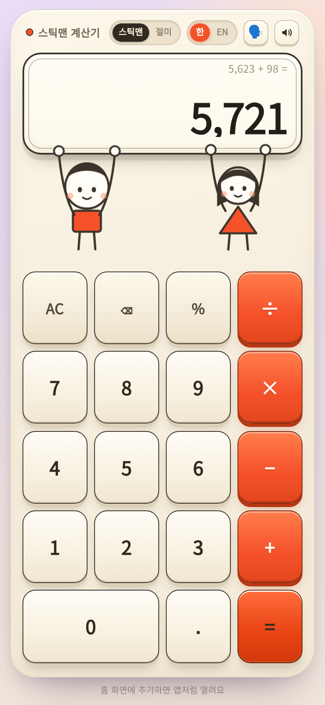
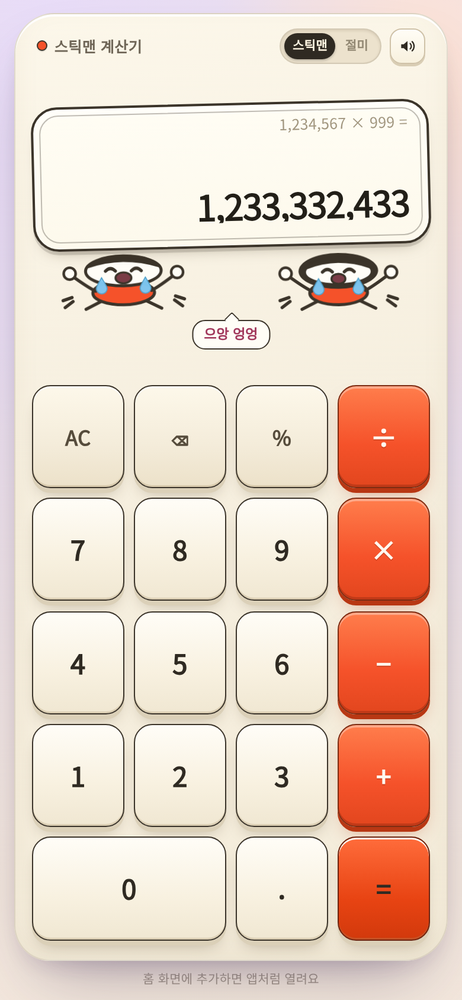

# 🧮 스틱맨 계산기

숫자판을 스틱맨 둘이 번쩍 받쳐 들고 있는 귀여운 계산기입니다.
안드로이드 폰 홈 화면에 추가하면 앱처럼 전체 화면으로 열립니다(PWA).

**지금 주소: <https://kimkyungse48-ui.github.io/stickman-calc/>** (GitHub Pages)

| 기본 | 무거운 숫자에 깔려서 엉엉 |
| --- | --- |
|  |  |

## 무엇이 되나요

- **계산**: 사칙연산 연속 계산, `%`, 소수점, 백스페이스, 천 단위 콤마
  - `0.1 + 0.2`를 `0.3`으로, `4.35 × 100`을 `435`로 딱 떨어지게 보정합니다.
  - `eval`을 쓰지 않는 문자열 상태 머신이라 안전하고, 0으로 나누면 `오류`로 막습니다.
- **스틱맨 애니메이션**
  - 평소: 숫자판을 들고 서서 살짝 들썩이고, 버튼을 누를 때마다 끄덕입니다.
  - `1,000,000` 이상(7자리~): 표정이 찡그려지고 땀방울이 튀며 부들부들 떱니다. `낑… 낑…`
  - `100,000,000` 이상·10자리 이상·`-100,000` 이하·오류: 숫자판에 깔려 납작해져 엉엉 웁니다. 눈물이 떨어지고 `으앙 엉엉`
  - `=`로 계산이 끝나면(정상 범위) 만세하며 반짝입니다.
- **캐릭터 모드**: 상단 토글로 `스틱맨` ↔ `절미`(핑크 `ㅈ` 캐릭터)를 바꿉니다. 카드 색도 살짝 분홍빛으로 바뀝니다.
- **효과음**: Web Audio API로 직접 만든 소리(버튼음·계산 완료음·낑낑·울음) — 음원 파일이 없습니다. 우측 상단 스피커 버튼으로 끄고 켜며, 설정은 기억됩니다.
- **음성 읽기**: 누른 키를 한국어로 읽어 줍니다(브라우저 내장 음성 합성, 외부 서버·음원 없음).
  - 숫자 `0~9` → 영·일·이·삼…구, `.` → 점, 기호는 더하기·빼기·곱하기·나누기·퍼센트, `AC` 초기화, `⌫` 지우기.
  - `=` → **"이꼴"** 하고 결과를 이어 읽습니다: `5,721` → "이꼴 오천칠백이십일", `-50` → "이꼴 마이너스 오십", `3.14` → "이꼴 삼점일사", 오류는 "오류".
  - 숫자를 빠르게 연속으로 누르면 직전 발화를 끊고 새 숫자를 바로 읽어 딜레이가 쌓이지 않습니다.
  - 상단 말풍선 버튼으로 켜고 끄며(기본 켜짐), 설정은 기억됩니다. 음성 합성을 지원하지 않는 브라우저에서는 조용히 넘어갑니다.
- **오프라인**: 서비스워커가 첫 방문 때 파일을 모두 캐시해 두어 비행기 모드에서도 열립니다.

## 폰에 앱처럼 설치하기

1. 안드로이드 크롬에서 <https://kimkyungse48-ui.github.io/stickman-calc/> 를 엽니다.
2. 오른쪽 위 ⋮ → **홈 화면에 추가** (또는 화면에 뜨는 **앱 설치** 버튼) → 설치.
3. 홈 화면의 스틱맨 아이콘을 누르면 주소창 없이 전체 화면으로 열립니다.

## 배포 (GitHub Pages)

이 저장소의 GitHub Pages는 **`gh-pages` 브랜치 루트**를 배포 대상으로 쓰고 있습니다.
(`main` 브랜치를 직접 소스로 지정하는 설정은 GitHub 앱 권한상 바꿀 수 없어 gh-pages를 씁니다.)

코드를 고친 뒤 배포하려면:

```bash
scripts/deploy_pages.sh      # main 커밋 → gh-pages로 밀어 넣고 사이트를 다시 빌드시킴
```

배포 후 1~2분 안에 <https://kimkyungse48-ui.github.io/stickman-calc/> 에 반영됩니다.
서비스워커는 화면(HTML)을 네트워크 우선으로 받아 새 배포가 다음 실행에 바로 보이고,
오프라인일 때만 캐시로 엽니다. 그래도 폰에서 옛 화면이 보이면 새로고침을 두 번 하거나
`sw.js`의 `CACHE` 이름을 `stickman-calc-v7`처럼 올려 주면 됩니다.

PC에서 먼저 볼 때는 이 폴더에서:

```bash
python3 -m http.server 8000
# 브라우저에서 http://localhost:8000
```

## 파일 구조

```
index.html              화면 뼈대
assets/styles.css       디자인(3D 키캡, 캐릭터 표정/모션)
assets/app.js           화면 동작·캐릭터 SVG·효과음
assets/calc.js          계산 엔진 + 한국어 수 읽기 (eval 없음, 단위 테스트 대상)
manifest.webmanifest    PWA 매니페스트 (standalone, 세로 고정)
sw.js                   서비스워커 (캐시 우선 → 오프라인 동작)
icon-192.png / icon-512.png / icon-maskable-512.png / apple-touch-icon.png
scripts/make_icons.py   아이콘 다시 그리기 (PIL)
tests/cases.js          계산 엔진·한국어 읽기 테스트 케이스 38개
tests/calc.test.mjs     Node로 테스트 실행
tests/run_cases.py      Node가 없을 때 브라우저(Playwright)로 같은 케이스 실행
tests/test.html         브라우저에서 눈으로 보는 테스트 결과
tests/ui_test.py        Playwright 화면·동작 테스트 + 스크린샷
tests/deploy_check.py   배포된 https 주소 검증 (계산·모션·매니페스트·SW·아이콘)
scripts/deploy_pages.sh main → gh-pages 배포
```

## 테스트

```bash
node tests/calc.test.mjs      # 계산 엔진 + 한국어 읽기 38개 → 38/38 통과
python3 tests/run_cases.py    # Node가 없으면 브라우저로 같은 케이스 실행
python3 tests/ui_test.py      # 화면·버튼·음성 읽기·모드 전환·오프라인·콘솔 오류 확인
python3 tests/deploy_check.py # 실제 배포 주소가 정상인지 확인
```

`tests/test.html`을 브라우저로 열면 같은 테스트를 화면에서 볼 수 있습니다.
`tests/ui_test.py`는 `pip install playwright && playwright install chromium`이 필요합니다.

## 기억해 두는 설정

- `localStorage`의 `stickman-calc-mode` — 마지막 캐릭터 모드
- `localStorage`의 `stickman-calc-sound` — 효과음 켜짐/꺼짐
